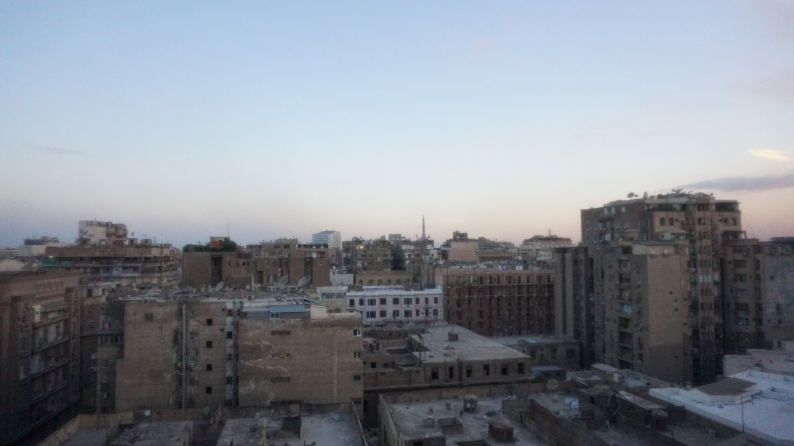

## An honest review of cairo

Cairo was my first city on my latest bout of traveling. Thanks to my latest job (Haiven), I have the ability to travel freely across the globe, given I attend all required meetings and such.  
  
I quickly settled on Cairo as my first stop in my lengthy plan. Why? Because the Great Pyramids were there. As haphazard as it sounds, that *really* is all the thought I gave it. I messaged a friend, Maria, who has been on a gap year in Europe, asking if she would like to come with. The deal was that I would pay for all the accommodation (I needed fast wifi and a washer because of the arrangement I had with my work) as long as she got herself there. Once she said the word, I booked our accommodation in a downtown neighborhood called El-Falawa - a modest 2 bedroom apartment on the 12th floor of a nondescript, beige apartment building (for reference - *every* apartment building in downtown Cairo is beige)

## the food

the food

### the people

the people

### the monuments

the monuments

### verdict

the verdict
